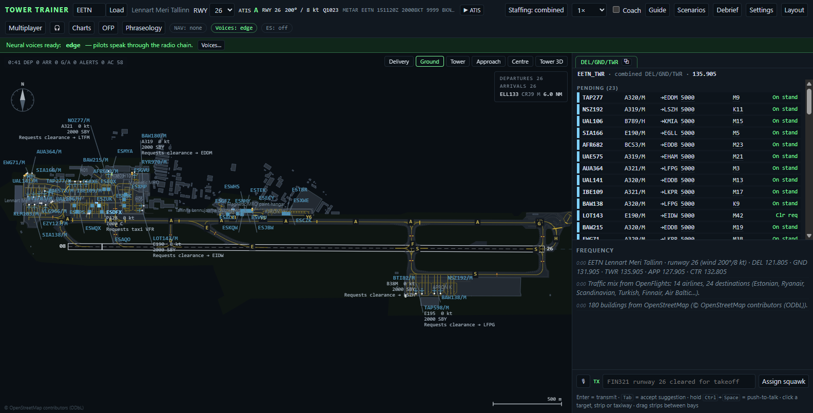
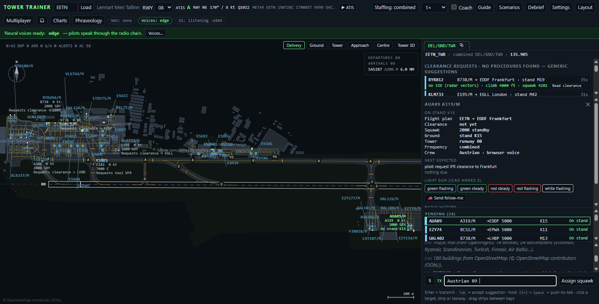
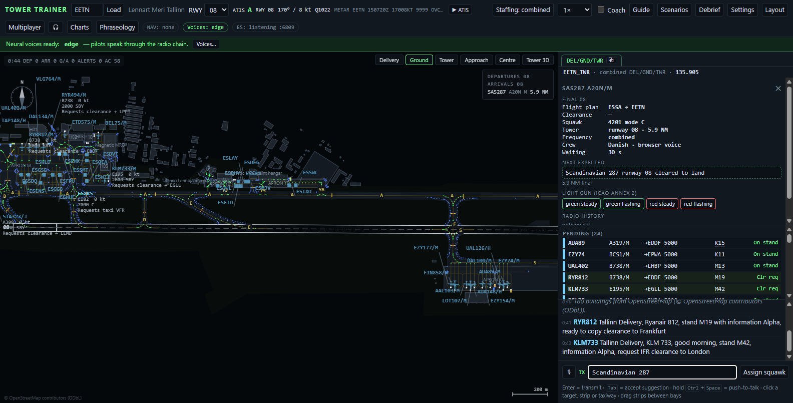
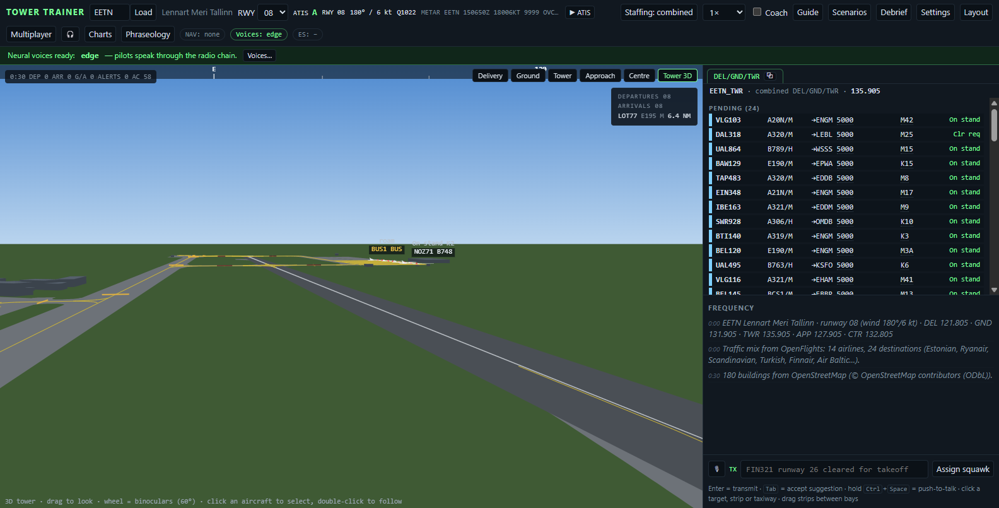
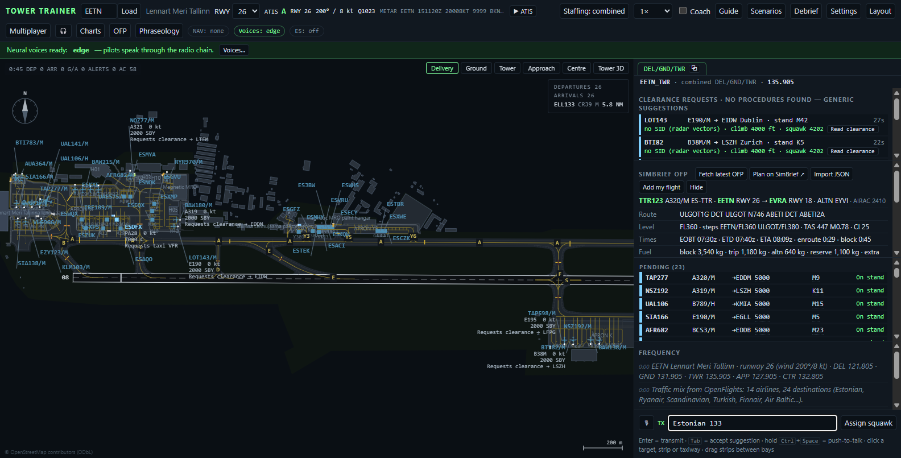
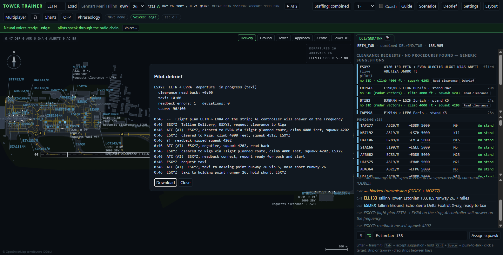

# Tower Trainer

[](https://github.com/Anviktor2411/TowerTrainer/actions/workflows/tests.yml)
[](LICENSE)

Offline practice for VATSIM Delivery / Ground / Tower / Approach / Centre at (almost) any airport in the world.
Airport layouts come from the X-Plane Scenery Gateway (cached in `cache/`), the runway from the live METAR.

| Ground view | Delivery | Tower at night |
|---|---|---|
|  |  |  |

**Install in one go (Windows):** right-click `installer/TowerTrainer-Setup.ps1` → *Run with PowerShell*. It checks
Python, downloads the trainer into `%LOCALAPPDATA%\TowerTrainer`, makes a desktop shortcut and opens the setup
wizard. Everything else: `start.bat` (Windows) / `start.sh` (macOS, Linux), then <http://localhost:8780>.

## Run

```
python server.py                       # http://localhost:8780  (?icao=EGLL), EuroScope/FSD on 127.0.0.1:6809
python server.py --fsd-port 0          # without the EuroScope bridge
python server.py --xradio 1.2.3.4:49100 --xradio-password word --xradio-callsign EETN_TWR
```

Python 3 (stdlib only) and Chrome or **Edge** (best "Natural" voices; push-to-talk uses the browser's speech recognition).

## What's in it

- **Positions**: Delivery, Ground, Tower, Approach, Centre with their own frequency (from apt.dat), login callsign
  (`EETN_TWR`, `EE_CTR`), strip board and frequency log. *Staffing*: work any combination; the rest are AI
  controllers with correct phraseology (grey). *Combined* keeps everything on one frequency.
  Pilots stay on a frequency until handed off ("contact Ground 131.905"); a wrong frequency sends them away
  until they come back with "no reply on …".
- **Pop-out windows** (⧉ on a position tab) for multi-monitor towers; BroadcastChannel, one sim in the main window.
- **Phraseology** by region (K…/C… = FAA, EG/EI = CAP 413, else ICAO): callsign-last readbacks (US mix),
  niner/tree/fife/tousand for strict crews, grouped flight numbers for native speakers, decimal vs point,
  spoken aircraft types, GA registrations abbreviated after ATC abbreviates, greetings by local time.
- **Pilot errors to catch**: readback errors (wrong squawk is really set), "say again", old ATIS letter,
  "confirm cleared for takeoff?" with traffic on the runway, missed-readback alert after 30 s.
- **Accents**: crews get a nationality from the airline/registration; non-native pilots speak English through their
  own language's voice with aviation words respelled (Estonian, Finnish, Latvian, Lithuanian, German tables).
  Settings → Accents Off / Natural / Strong, voice table shows what is installed.
- **Radio**: squelch click and tail, band-passed static + crackle during speech (louder far away), random reply
  delays, blocked transmissions with a heterodyne squeal.
- **Squawks**: local code blocks (data.js), never reserved/in-use codes, 10-min reuse delay, "Assign squawk";
  label warnings for wrong code / no mode C / duplicates; optional scripted 7600/7700 events.
- **Guide** (interactive tutorial, English/Estonian), **Coach** mode with ICAO/CAP 413/FAA references, **Debrief**.

## EuroScope

EuroScope → Connect → Connect type **Direct to VATSIM**, untick **Connect to VATSIM**, server `127.0.0.1`,
any callsign (e.g. `EETN_TWR`) and password, load a sector file, prime the tower frequency. Text on your
frequency (or private to a pilot) is handled exactly like typing in the trainer.

## XRadio (optional, off by default)

Settings → XRadio: server, port, password, ATC callsign/frequency, and toggles for AI traffic into X-Plane,
real pilots on the radar, text, voice both ways (WebCodecs Opus in the browser; AI pilots' speech is rendered
on the server and encoded with PyAV or opuslib when one is installed, text otherwise), weather from or to the
flight, ATIS on its own frequency and optional transcripts of the pilots (Vosk/Whisper, never acting on their
own). `xradio/protocol.py` is vendored from XRadio v0.6.0 (MIT, protocol 6); a v0.5.7 server still works with
the older feature set. `xradio/check_win_imports.py` (the setup wizard's DLL check) comes from XRadio too. The status pill shows `XR: v6 · 3 pilots · 12 AI`; the XRadio settings have a short
"how to fly with TowerTrainer ATC" text for the pilots.

## Learning: scenarios, career path, replay, statistics

**Scenarios** (header button): a career path from Delivery to "everything at once" where each level opens when a
scenario of the level before is passed; the result is the phraseology score plus the goals (missed readbacks,
conflicts, go-arounds) in the debrief. Scenarios are plain objects: copy a built-in one or make your own in the
editor (airport, runway, positions, rates, weather, LVP, abnormals, duration, goals), export/import them as JSON.
The session is recorded all the time (one frame per second): **Replay** scrubs it on the radar with the frequency
log following, and a recording can be saved and loaded again later. The debrief exports the log (.txt) and the whole
session (.json) and every finished session goes into **Statistics** (score trend, table). The coach now also gives
timing and separation hints: a departure waiting with the runway free, a late landing clearance, wake turbulence
behind a heavy, arrival spacing, a runway not vacated. **Charts** lists the SIDs/STARs/approaches of the airport
(from your own Navigraph / X-Plane / EuroScope data), lets you show only some on the radar and links to chart
sites (the link is a setting; nothing is bundled).

## Tower 3D

A view tab next to the radar pictures: the airport seen from the tower cab, drawn with the ordinary canvas (no
WebGL, no libraries). Pavement, runways with markings and lights, taxiway lines, OpenStreetMap buildings extruded
by their height, aircraft as silhouettes with labels, day/night, fog. Drag to look around, wheel for binoculars,
click an aircraft to select it, double-click to follow it. Alt+6.



## Setup wizard

<http://localhost:8780/setup> (local PC only). Step by step: Python and the optional packages with their sizes
(installed only with this Python's own pip); EuroScope detection (never bundled — it links to euroscope.hu),
radar files either from a sector package you supply (unpacked into `Documents\EuroScope\<package>`) or generated
from the trainer's own airport data (`TowerTrainer_<ICAO>.sct/.ese/.asr` + a profile that connects to
127.0.0.1 with "Connect to VATSIM" off, and a desktop shortcut); X-Plane 12 detection (installer list and Steam),
the Navigraph AIRAC in `Custom Data`, installing or updating the XRadio plugin from its GitHub release zip with a
backup of the old folder, and filling `xradio.cfg`. Before installing, the wizard reads `XRadio.xpl`'s DLL imports
with XRadio's own check (`xradio/check_win_imports.py`) and refuses a build X-Plane could not load — one linked
against the MinGW runtime (`libstdc++-6.dll` …) says so in red and leaves the installed plugin alone. Once
X-Plane has run, the XRadio row shows what its `Log.txt` says: loaded, or a red line with X-Plane's own error
(`Error Code = 126 : The specified module could not be found.`). Finally tests of voices, microphone, speech recognition,
EuroScope and XRadio with a green/red light and a fix line each. Nothing is written outside the folders the page
shows, nothing is overwritten without ticking "allow overwriting", every action has a dry run, and `setup.log`
keeps the record. `python server.py` on another PC does not expose the wizard.

## SimBrief: your real flight plan in the trainer



Settings → SimBrief: your SimBrief username or Pilot ID (kept in this browser only) and the units. The **OFP**
button opens the panel: *Fetch latest OFP* asks SimBrief's documented API for your latest flight
(`xml.fetcher.php?username=…&json=1`; HTTP 400 means an unknown user or no flight planned yet, and the panel
says so), *Plan on SimBrief* opens SimBrief's own new-flight page (with an API key from SimBrief support it uses
the official API form flow instead), *Import JSON* loads an OFP file you downloaded by hand. The panel shows the
callsign, type and registration, planned runways, SID/STAR and route, level and step climbs, times, fuel, weights
against their limits, equipment, the ICAO flight-plan string, every waypoint with wind and time, the METAR/TAF at
both ends and the link to the full OFP; the route is drawn on the Tower/Approach/Centre pictures. **Add my
flight** spawns the OFP as a departure (when the trainer's airport is its origin) or an arrival (its destination)
with exactly the plan's data — callsign, type, registration, a stand that fits, route, SID when it is one of the
runway's, cruise level, the EOBT — so Delivery can give a clearance that matches the real plan; the coach
compares your clearance with it (destination, SID, level), and EuroScope receives it as a full `$FP` with the
ICAO equipment, cruise level, alternate and `/V/ SIMBRIEF` remarks. Nothing is
fetched unless you press a button (plus at most one automatic load when a session starts, if ticked), nothing is
scraped, and the last OFP is cached in `cache/simbrief/` (not committed). `simbrief.py` holds the parser.

**From the cockpit (XRadio v0.6.0):** in X-Plane, XRadio → Flight plan → *Import from SimBrief* fetches
the same OFP into the plugin (SimBrief username or Pilot ID in XRadio's Settings → SimBrief), lets the pilot
edit it and *File* it to the controller; the plan arrives on the strip here with route, RFL, alternate,
EOBT and equipment, and goes into EuroScope's `$FP` with the `SIMBRIEF` remark. The clearance you give
(squawk, SID, level) shows up in XRadio next to the pilot's plan, with differences marked.

## AI controllers for your own flight



Fly the SimBrief plan yourself: file it from XRadio (Flight plan → Import from SimBrief → File) and the
positions nobody staffs in TowerTrainer answer you -- Delivery with the clearance built from the filed
plan (SID, initial climb, a squawk), a readback check ("negative, squawk 4521, read back"), Ground with
pushback and a taxi route from where you really are, watching the real position (moving without a
clearance, leaving the route, entering a runway: you are told and it goes into the debrief), Tower with
line-up and takeoff against the trainer's traffic, Radar and Control with the climb and the handoffs,
and for an arrival the approach, the landing clearance once you have checked in with Tower, vacating
and a stand. Leaving the departure airspace ends the departure there, not your flight plan: load the
destination in TowerTrainer (it works one airport at a time) and its AI controllers take the arrival.
Whatever position you staff yourself stays yours: the AI is silent there and the strip, the Delivery
panel and the coach work as always. Spoken numbers in transcripts ("four five two one", "flight level
one two zero") are understood. With transcripts off, a keyed microphone counts as a call -- after four
seconds, in case a transcript is still coming -- and readbacks are taken as correct. Settings → XRadio:
*AI controllers handle real pilots where nobody is staffed*. Delivery panel → **Debrief**: every call,
the deviations, the timings and a score, downloadable. `web/js/pilotatc.js` holds the logic;
`tests/ops.test.mjs` flies a departure and arrivals through it, and `tests/aiatc.test.mjs` flies a
scripted XRadio pilot from a stand at EETN to a stand at EVRA through XRadio's own server.

## Control from the tower in X-Plane

With the XRadio plugin (v0.6.0) you can sit in the tower cab inside X-Plane and work the trainer's traffic
from there. `server.py` opens a *tower link* on `127.0.0.1:8781` (`--tower-port 0` to switch it off,
`--host 0.0.0.0` for another PC's X-Plane); tick Settings → XRadio → **X-Plane tower link** so the trainer's
window hosts a session with the code `TOWER`, then Plugins → XRadio → *Tower mode* in X-Plane. The plugin
is a remote controller of that session: it gets the same state as a pop-out window — with the Delivery
list (the suggested SID, climb and squawk and the trainer's own clearance text for each request) and the
stop-bar state — plus the airport's runways, stands, taxi network and pavement for its ground radar, and
sends back transmissions, strip acceptances and moves between bays, and operations (LVP, runway, stop
bars). The trainer stays the authority; the plugin only shows and asks. The setup wizard installs the
plugin; details in XRadio's `docs/tower-mode.md`.

## Several controllers, several screens

* **Windows** – any position, or a single panel of it (radar, strips, log, Delivery list, weather, sequence,
  chat), opens in its own window from the position tab's ⧉ or **Layout** (Alt+L). Presets put the windows on
  your monitors (Chrome/Edge ask once for the window-management permission; Firefox reopens them where you
  left them); every window has a ⛶ full-screen button. Audio only ever plays in the main window.
* **Multiplayer** – **Multiplayer** (Alt+M) → *Host a session*: you get a six-letter code and a link.
  Others on your network open the link (start the server with `python server.py --host 0.0.0.0`) and join
  as a controller, spectator or instructor with just a nickname. A controller claims a position by clicking
  its tab; the host's tab shows who works it, and a position whose controller drops goes back to the AI after
  30 s. Handoffs between positions must be accepted (the incoming strip flashes with ACCEPT), coordination
  requests (release / crossing / approval / point-out) go to whoever works the other position (an AI position
  answers in a few seconds), there is a text chat, private notes from the instructor, kick/ban, and an
  intercom (hold Alt+Shift or 🎧) over WebRTC between the controllers. Everything travels over one WebSocket
  relay in `server.py` (`ws.py`, stdlib only).
* **Strip board on a phone or tablet** – `http://<host>:8780/?join=CODE&role=board&pos=TWR`: big strips,
  tap a strip to move it between bays, tap ACCEPT for incoming ones.
* **Command line** – suggestions as you type (callsigns on your frequency, then the next instruction for that
  aircraft); Tab accepts, / focuses the line, Alt+1…5 switch views, Alt+Q/W/E/R/T positions. Clicking a
  taxiway on the map appends it to the taxi instruction you are typing. Push-to-talk works in Firefox too:
  the server's Vosk or Whisper recognises what you said, biased with the callsigns in use.

## Packaging

`start.bat` / `start.sh` start the server and open the browser. `pyinstaller TowerTrainer.spec` builds a
`dist/TowerTrainer/` folder with the server, the page and the vendored XRadio protocol (optional engines only when
they are installed in that Python). `.github/workflows/tests.yml` runs the Python and Node suites on every push
(the airport-dependent ones fetch EETN from the Gateway first).

## Licence and credits

MIT (see `LICENSE`). Airport layouts: X-Plane Scenery Gateway (Laminar Research). Buildings and the tower
position: © OpenStreetMap contributors (ODbL). Airlines, routes and airports: OpenFlights (ODbL). Weather:
aviationweather.gov. Procedures: your own Navigraph / X-Plane / EuroScope files, read locally and never copied
into the repository. XRadio protocol module: XRadio (MIT, Anviktor2411). Data downloaded at run time is cached
in `cache/` with its fetch date; the OSM and OpenFlights snapshots age with it — delete the cache to refresh.

## Tests

```
node tests/unit.test.mjs                      # phraseology, voices, squawks, readback errors, positions, AI, coach
node tests/flow.test.mjs EGLL [RWY|-|-0] [SEED]   # full departure + arrival at a cached airport
python tests/fsd_test.py                      # EuroScope / FSD protocol
set XRADIO_DIR=...\xradio-0.5.7 && python tests/xradio_test.py   # against XRadio's own server + fake client
node tests/browser.test.mjs                   # real page in headless Chrome incl. pop-outs, a multiplayer session and the whole guide
node tests/ops.test.mjs                       # operations, weather, handoffs, autocomplete
python tests/ws_test.py                       # the multiplayer relay (WebSocket framing, roles, claims, kick/ban)
node tests/firefox.mjs                        # the same page in headless Firefox over WebDriver BiDi (TT_BROWSER=edge runs browser.test in Edge)
python tests/sector_test.py                   # generated EuroScope .sct/.ese/.asr/.prf for EETN and EGSS parse back
python tests/setup_test.py                    # the setup wizard on a temporary folder, dry runs, its HTTP API
python tests/towerlink_test.py                # the X-Plane tower link: hello, airport line (taxi network, pavement), claims, transmissions, ops
python tests/simbrief_test.py                 # the SimBrief OFP parser on a made-up fixture, fetch errors, cache, plan links
node tests/aiatc.test.mjs                     # S5: a scripted XRadio pilot flown EETN → EVRA by the AI controllers, end to end (XRADIO_DIR or ../xradio-main)
```
